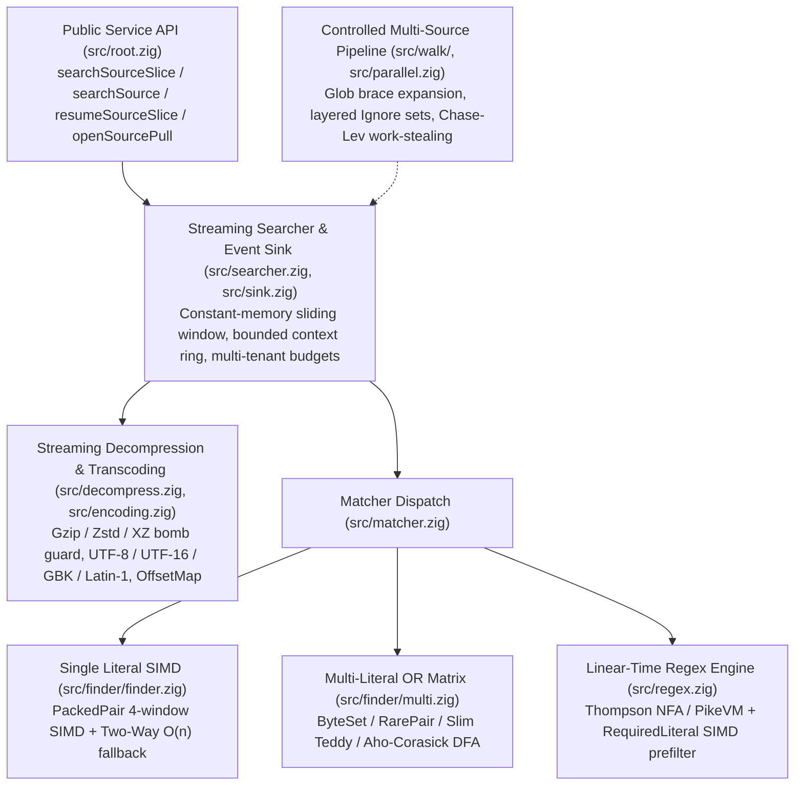

# libwebgrep Architecture & Design

`libwebgrep` is a pure Zig (`0.17.0`) text and regular expression search library engineered for multi-tenant server workloads, log analytics, and code search services. It requires zero third-party dependencies and does not link `libc`.

---

## 1. Layered Architecture

1. **SIMD Search Kernels (`src/finder/`, `src/regex.zig`)**: Pure in-memory substring, multi-pattern, and regular expression engines. Zero I/O. Single-literal search performs zero heap allocations; `Multi` and `Regex` allocate immutable tables at construction time and perform zero allocations during `find`.
2. **Streaming Decompression & Transcoding (`src/decompress.zig`, `src/encoding.zig`)**: Bomb-safe streaming Gzip/Zstd/XZ decompression and BOM/charset transcoding (UTF-8, UTF-16LE/BE, GBK, Latin-1) with monotonic `OffsetMap` anchors that map decoded UTF-8 byte offsets back to raw stream offsets (`raw_offset`).
3. **Streaming Searcher (`src/searcher.zig`, `src/sink.zig`)**: Handles line framing, fused single-pass NUL binary detection, constant-memory sliding windows for ultra-long lines, bounded circular before-context buffers, cursor pagination (`Flow.pause` / `resumeSourceSlice`), and strict multi-tenant budgets.
4. **Multi-Source Filtering & Scheduling (`src/walk/`, `src/parallel.zig`)**: Byte-oriented glob matching with nested brace expansion, hierarchical `.gitignore`/`.ignore`/`.rgignore` evaluation, custom file-type tables, and a lock-free Chase-Lev work-stealing scheduler bounded by `max_concurrency`.

---

## 2. Single-Literal SIMD Kernel (`Finder`)

- **`memchr` (`src/finder/memchr.zig`)**: Parameterized over 16-byte and 32-byte vectors. Provides `find`, `findEither` (4-vector unrolled 64-byte loop reaching **62.4 GB/s**), `findAny`, `findLast`, and vectorized `u8` horizontal accumulator `count` (up to 255 iterations before widening to `u64`). On `aarch64` NEON, first-match lane extraction uses `nibbleMask` (`u16` shift-by-4 narrowing `shrn` + `@ctz / 4`).
- **`PackedPair` (`src/finder/packed_pair.zig`)**: Selects the two rarest bytes in the pattern using the frequency rank table (`src/finder/frequency.zig`). Scans 4 SIMD windows per loop iteration (`64` bytes on 16-byte vectors, `128` bytes on 32-byte vectors). ASCII case-insensitive mode uses branchless bitwise folding `(block | 0x20) == lower_splat` (**42.6 GB/s** sensitive, **24.9 GB/s** case-insensitive).
- **`TwoWay` (`src/finder/two_way.zig`)**: Crochemore-Perrin critical factorization with $O(m)$ preprocessing and worst-case $O(n)$ search in $O(1)$ space. Patterns longer than 32 bytes automatically switch from `PackedPair` to `TwoWay` if candidate verifications exceed 50 with an average skip under 8 bytes.

---

## 3. Multi-Literal OR Engine Matrix (`Multi`)

`Multi.init` validates pattern count (`<= 1024`) and total pattern bytes (`<= 256 KiB`) before allocating. Smart case (`CaseMode.smart`) is evaluated **per pattern independently**. When `unicode_case` is enabled, Unicode Simple Case Folding equivalents (`src/finder/unicode_fold.zig`) are expanded into the pattern set.

`Multi` selects the fastest applicable SIMD engine in order:

1. **`ByteSet` (`src/finder/byteset.zig`)**: Used when all patterns are 1 byte long (`<= 16` folded bytes). Unrolls 4 SIMD vectors (`64` bytes/iter) with compile-time specialized broadcast comparisons (**34.2 GB/s**).
2. **`RarePair` (`src/finder/pairs.zig`)**: Used when all patterns are `>= 2` bytes and yield `<= 16` distinct rare adjacent byte pairs. Dispatches a 2-stage direct vector comparison for `<= 2` pairs or an 8-bucket shift-hash (`first +% (second << 7)`) across 4 vectors (**32.2 GB/s**).
3. **`Teddy` (`src/finder/teddy.zig`)**: Used for `1..32` patterns (`neon` on `aarch64`, `ssse3`/`avx2` on `x86_64`). Uses a single-group 8-bucket nibble lookup (`vtbl` / `pshufb` / `vpshufb`) with 2-phase primary-then-secondary fingerprint verification across 4 vectors (**24.1 GB/s**).
4. **`AhoCorasick` (`src/finder/aho.zig`)**: Byte-equivalence-compressed dense DFA for arbitrary pattern sets. Includes a 64-byte SIMD skip loop at `state == 0` using a 16-byte high-nibble bucket bitmap so unmatched regions are skipped at **24.3 GB/s** without stepping the DFA byte-by-byte.

---

## 4. Linear-Time Regular Expression Engine (`Regex`)

`src/regex.zig` implements a backtracking-free Thompson NFA / PikeVM engine:

- **Compile Size Hard Cap**: Rejects patterns exceeding `inst_count_hard_cap` (`4096` NFA instructions) or `multiline_window_hard_cap` (`8 MiB`) with `error.RegexTooLarge` before scanning.
- **Strict $O(n)$ Step Guarantee**: Maintains two pre-allocated thread lists (`curr` and `next`) with per-step `visited` generation tags. Each NFA instruction is visited at most once per input byte.
- **Required-Literal SIMD Prefilter**: Extracts mandatory literal prefixes and trailing literals from the regex AST and attaches a `Finder` prefilter. On haystacks where the required literal is rare, `Regex` scans at **42.9 GB/s**.
- **Bounded Multiline Matching**: When `multiline` is enabled, matches may span across `\n` up to `max_multiline_window` (`64 KiB` default). Once the window is exhausted without completing a match, the candidate fails immediately without unbounded upstream reads.

---

## 5. Streaming Searcher, Decompression & Security Boundaries

- **Fused Single-Pass Binary Detection**: NUL byte detection is fused directly into the SIMD search loop (`findWatched` / `findWatchingNul`), avoiding a separate pass over each buffer.
- **Constant-Memory Ultra-Long Lines**: Lines exceeding `max_line_len` (`2 MiB` default, `8 MiB` hard cap) continue streaming in constant memory and emit a bounded preview window around matches (`truncated = true`, `line_len`, `window_start`).
- **In-Process Bomb-Safe Decompression**: `src/decompress.zig` streams Gzip, Zstd, and XZ in-process while enforcing both `max_decompressed_bytes` and `max_compression_ratio` (default `100:1`) on every chunk to stop Zip Bombs immediately (`LimitHit.decompressed_bytes`).
- **Hard Security Invariants**:
  - Public search entry points never accept filesystem paths (preventing path traversal / CWE-22).
  - Never spawns child processes (`execve`, `posix.spawn`).
  - Directory walker (`src/walk/walker.zig`) never follows symlinks, never reads parent directories above the root, and never reads global host configuration.
  - Worker concurrency (`src/parallel.zig`) is strictly governed by caller-supplied `max_concurrency` without probing host CPU core counts.
