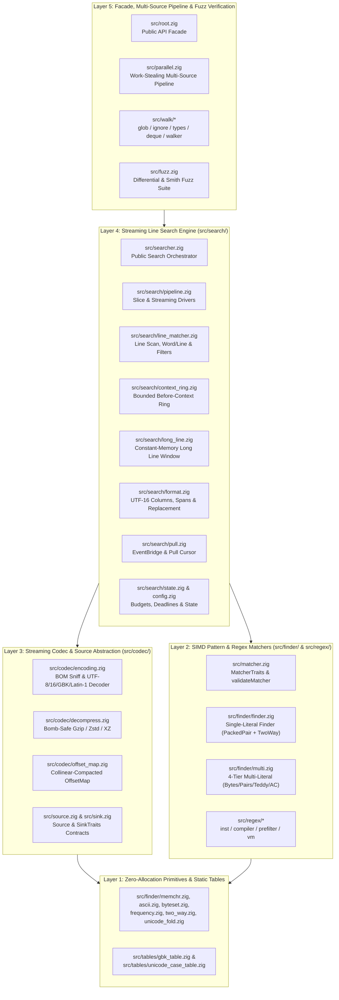

# libwebgrep 5-Layer Architecture & Co-Development Guide

[English](ARCHITECTURE.md) | [简体中文](ARCHITECTURE.zh-CN.md)

`libwebgrep` is structured as a strict **5-Layer Acyclic Architecture** engineered for both human readability and AI-assisted co-development:

1. **Accuracy First**: Every SIMD kernel, Thompson NFA transition, streaming transcode/decompression boundary, and line-context window is backed by deterministic unit tests and differential fuzzing (`src/fuzz.zig`).
2. **Extreme Performance Second**: Zero-cost `comptime` monomorphization across layers, 4-vector unrolled SIMD loops (`@Vector`, `@splat`), branchless ASCII/Unicode case folding, and `@branchHint(.cold)` on fallback paths.
3. **Elegant Code Taste & Co-Development Third**: Implementation files are scoped to a single clear responsibility (typically **150–800 lines**), with standardized English module headers (`//! [Module]`, `//! [Layer]`, `//! [Role]`, `//! [Invariants]`).

---

## 1. Five-Layer Architecture Overview

Dependencies flow strictly downward from Layer 5 to Layer 1. Lower layers never import higher layers.



---

## 2. Module Inventory by Layer

### Layer 1: Zero-Allocation Primitives & Static Tables
- `src/tables/unicode_case_table.zig`: Pure static lookup tables for Unicode Simple Case Folding (`FoldGroup`, multi-way equivalence classes, and Unicode word character ranges).
- `src/tables/gbk_table.zig`: Compact 24 KiB two-stage page index for GBK / GB2312 to Unicode codepoint decoding.
- `src/finder/memchr.zig`: 4-vector unrolled SIMD byte search (`find`, `rfind`, `findEither`, `findAny`, `countByte`).
- `src/finder/ascii.zig`, `src/finder/byteset.zig`, `src/finder/frequency.zig`, `src/finder/two_way.zig`: Branchless ASCII case folding, 16-bucket SIMD byte sets, empirical byte frequency ranks, and $O(n)$ Two-Way substring search.

### Layer 2: Pattern Matchers (`src/matcher.zig`, `src/finder/`, `src/regex/`)
- `src/matcher.zig`: Defines `Match`, `MatchMode`, `FindOptions`, `MatcherTraits(M)`, and `validateMatcher(M)`.
- `src/finder/finder.zig`, `src/finder/packed_pair.zig`, `src/finder/unicode_fold.zig`: Single-pattern literal matcher with SIMD packed-pair filtering, adaptive `TwoWay` fallback, and SIMD-prefiltered Unicode case folding.
- `src/finder/multi.zig`, `src/finder/pairs.zig`, `src/finder/teddy*.zig`, `src/finder/aho.zig`: 4-tier multi-pattern OR engine (`ByteSet` -> `RarePair` -> `Teddy` -> `AhoCorasick`).
- `src/regex.zig` & `src/regex/` (`inst.zig`, `compiler.zig`, `prefilter.zig`, `vm.zig`, `tests.zig`): Modular linear-time Thompson NFA / PikeVM regular expression engine with automatic prefix, interior, tail, and alternation SIMD prefiltering.

### Layer 3: Streaming Codec & Source Contracts (`src/codec/`, `src/source.zig`, `src/sink.zig`)
- `src/codec/offset_map.zig`: Strongly-typed `SearchByteOffset` and `RawByteOffset` with collinear-slope-compacted sparse anchor mapping (`OffsetMap`).
- `src/codec/decompress.zig`: In-process streaming Gzip, Zstd, and XZ decompression with dual Zip-Bomb budgets (`max_decompressed_bytes` and `max_compression_ratio`).
- `src/codec/encoding.zig`: BOM sniffing and comptime-specialized transcoding (`UTF-8`, `UTF-16LE`, `UTF-16BE`, `GBK`, `Latin-1`).
- `src/sink.zig`: Defines `Event`, `LineEvent`, `Result`, `Flow`, and `SinkTraits(S)` for compile-time sink introspection.

### Layer 4: Streaming Line Search Engine (`src/searcher.zig` & `src/search/`)
- `src/search/config.zig`: `SearchConfig` and multi-tenant hard caps.
- `src/search/state.zig`: Per-search mutable `State`, monotonic clock deadlines, byte budgets, and comptime matcher capability dispatch.
- `src/search/context_ring.zig`: Seek-free `BeforeRing` circular buffer and `previewLine` centering.
- `src/search/format.zig`: UTF-16 column calculation, non-overlapping match span collection, `$0`–`$9` regex capture expansion, and `sinkLine` formatting.
- `src/search/line_matcher.zig`: Core `matchBuffer`, `findLine`, `matchInvert`, `whole_word` / `whole_line` verification, and `contains` / `excludes` secondary filtering.
- `src/search/long_line.zig`: Constant-memory sliding window (`beginLong`, `pumpLong`, `finishLong`) for lines exceeding `max_line_len`.
- `src/search/pull.zig`: `EventBridge(S)` adapter and `Puller` pull-mode iterator (`openSourcePull`).
- `src/search/pipeline.zig`: High-level `materialize`, `searchPrepared`, and `drive` streaming state machine.

### Layer 5: Multi-Source Pipeline, Public Facade & Differential Fuzzing
- `src/walk/` (`glob.zig`, `ignore.zig`, `types.zig`, `file_id.zig`, `list_dir.zig`, `linux_getdents.zig`, `deque.zig`, `walker.zig`) & `src/parallel.zig`: Controlled work-stealing multi-source traversal and parallel search.
- `src/root.zig`: Public API facade verified at build time against `docs/API.md` and `docs/API.zh-CN.md`.
- `src/fuzz.zig`: Differential and property-based fuzzing suite (`zig build fuzz`).

---

## 3. Extensibility Guide

### 3.1 Adding a New Pattern Matcher (`MatcherTraits`)
Any pointer `*M` or `*const M` passed to `searchSlice`, `searchSourceSlice`, `searchSource`, or `openSourcePull` is validated at compile time by `validateMatcher(@TypeOf(matcher))` in `src/matcher.zig`.
- **Required**: `pub fn find(self: *M, haystack: []const u8, start: usize, mode: MatchMode) ?Match`
- **Optional Zero-Cost Hooks** (automatically detected via `MatcherTraits(M)`):
  - `findWatched(self: *M, haystack: []const u8, start: usize, nul: *?usize) ?Match` — Fuses single-pass NUL binary detection.
  - `findAllowed(self: *M, haystack: []const u8, start: usize, mode: MatchMode, comptime allow: fn ([]const u8, usize, usize) bool) ?Match` — Enables fast in-kernel `whole_word` boundary filtering.
  - `acceptsSpan(self: *const M, haystack: []const u8, start: usize, end: usize) bool` — Custom `whole_line` check.
  - `isMultiline(self: *const M) bool` and `multilineWindow(self: *const M) usize` — Enables cross-line matching windows.

### 3.2 Adding a New Character Encoding (`src/codec/encoding.zig`)
1. Add the enum tag to `Encoding` and `Sniff` in `src/codec/encoding.zig`.
2. Add the WHATWG/MIME aliases in `parseCharsetLabel`.
3. Add the decoding branch in `decodeStepMode` (which automatically specializes both the whole-slice `convertIntoWithMap` fast path and the streaming `Decoder.emitPending` state machine at `comptime`).

---

## 4. Zig `0.17.1` Idioms & Verification Commands

- **SIMD & Branch Hints**: Use `@Vector(width, u8)` with `@splat(...)` and annotate error/fallback branches with `@branchHint(.cold)` so hot loops remain compact in instruction cache.
- **Unmanaged Containers**: Prefer `std.ArrayList(T) = .empty` with explicit allocator passing.
- **Verification**:
  ```sh
  zig build test --summary all
  zig build fuzz --summary all
  zig build bench -Doptimize=ReleaseFast -Dteddy=avx2
  ```
