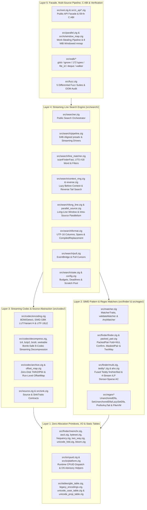

# libwebgrep 5-Layer Architecture & Co-Development Guide (`v0.10.0`)

[English](ARCHITECTURE.md) | [简体中文](ARCHITECTURE.zh-CN.md)

`libwebgrep` is structured as a strict **5-Layer Acyclic Architecture** engineered for both human readability and AI-assisted co-development:

1. **Accuracy First**: Every SIMD kernel, DFA/NFA transition, streaming transcode/decompression boundary, and line-context window is backed by deterministic unit tests, 5 cross-layer differential fuzz suites, and a `std.testing.checkAllAllocationFailures` OOM injection audit (`src/fuzz.zig`).
2. **Extreme Performance Second**: Zero-cost `comptime` monomorphization across layers, 4-vector unrolled SIMD loops (`@Vector`, `@splat`, `@ctz`/`@clz`), adaptive 4-stream ILP Aho-Corasick, zero-copy 8 MiB windowed `mmap`, 64B-aligned `preadv`, and `@branchHint(.cold)` on fallback paths.
3. **Elegant Code Taste & Co-Development Third**: Implementation modules are scoped to clear responsibilities with standardized English module headers (`//! [Module]`, `//! [Layer]`, `//! [Role]`, `//! [Invariants]`).

---

## 1. Five-Layer Architecture Overview

Dependencies flow strictly downward from Layer 5 to Layer 1. Lower layers never import higher layers.



---

## 2. Module Inventory by Layer

### Layer 1: Zero-Allocation Primitives, Low-Level I/O & Static Tables
- `src/tables/unicode_prop_table.zig` & `src/tables/unicode_case_table.zig`: Pure static lookup tables for Unicode Simple Case Folding (`FoldGroup`), Unicode General Category & Script properties (`\p{...}` / `\P{...}`), and **UTS #18 Unicode 16.0 `prop_Word`** (`Alphabetic | M | Nd | Pc | Join_Control`) sorted non-overlapping codepoint range tables for $O(\log K)$ binary-search word-boundary classification.
- `src/tables/gbk_table.zig` & `src/tables/legacy_encodings.zig`: Complete 23,940-entry CP936/GBK/GB2312 lookup table (paired with a direct UTF-8 LUT in `encoding.zig`) plus compact tables for Windows-1252, Windows-1251, GB18030, Shift-JIS, EUC-JP, Big5, and EUC-KR.
- `src/finder/memchr.zig`: `@ctz`/`@clz`-accelerated 4-vector unrolled SIMD byte search (`find`, `rfind`, `findEither`, `findAny`, `countByte`) plus **`findSepOrNul`** (probes both record separator `\n` and binary sentinel `\0` within a single SIMD vector).
- `src/finder/ascii.zig`, `src/finder/byteset.zig`, `src/finder/frequency.zig`, `src/finder/two_way.zig`, `src/finder/bloom.zig`: Branchless ASCII case folding, 16-bucket SIMD byte sets, empirical byte frequency ranks, $O(n)$ Two-Way substring search, and N-gram Bloom pre-screening.
- `src/io/cpuid.zig` & `src/io/platform.zig`: Runtime `CPUID + OSXSAVE + XGETBV` ISA probing for `-Dteddy=runtime` and OS-specific `POSIX_FADV_SEQUENTIAL` / `MADV_SEQUENTIAL` helpers.

### Layer 2: Pattern Matchers (`src/matcher.zig`, `src/finder/`, `src/regex/`)
- `src/matcher.zig`: Defines `Match` (with `pattern_id`), `MatchMode`, `FindOptions`, `MatcherTraits(M)`, `validateMatcher(M)`, and runtime type-erased `AnyMatcher`.
- `src/finder/finder.zig`, `src/finder/packed_pair.zig`, `src/finder/unicode_fold.zig`: Lock-free `*const Finder` single-pattern literal matcher featuring `PackedPair` with inline `confirmFast` / `confirmFastFold` and `watch_nul` confirmation, exact single-bit `MaskedPair` SIMD matching, adaptive `TwoWay` fallback, and ASCII-prefiltered Unicode case folding.
- `src/finder/multi.zig`, `src/finder/pairs.zig`, `src/finder/teddy*.zig`, `src/finder/aho.zig`: Lock-free `*const Multi` 4-tier multi-pattern OR engine reporting exact `pattern_id`:
  - **Fused `Teddy` (`findVerified` / `findVerifiedWatchingNul`)**: 8-bucket Slim Teddy (`avx2`, `ssse3`, `neon`, `avx2_rt`) with bucket-aware ghost-byte avoidance, all-digit `(1,2)` window penalty, 3-byte inline filter, and uninterrupted `vpminub` callback verification so `AltDfaVerifier` never restarts the SIMD loop on decoys.
  - **Hybrid Dense+Sparse 4-Stream ILP `AhoCorasick` (`src/finder/aho.zig`)**: Combines a cache-resident pre-multiplied dense DFA prefix (depth 0, all depth-1, and frequency-ordered BFS depth-2 states under L2 cell budgets with `MATCH_BIT`/`SPARSE_BIT` packed into `u32` transitions) with a compact contiguous sorted-edge NFA for deeper states (500–2,000+ patterns), AVX2 high-nibble skip, and **adaptive 4-stream ILP** scanning.
- `src/regex.zig` & `src/regex/` (`inst.zig`, `compiler.zig`, `prefilter.zig`, `dfa.zig`, `vm.zig`, `set.zig`):
  - **Two-Tier Unanchored Set DFA (`SetUnanchoredDfa` Tier A + `LazySetDfa` Tier B)**: Wired into both `RegexSet` and single `Regex` for fast unanchored multi-branch and no-literal scanning, backed by byte equivalence classes (`ByteClasses`).
  - **Specialized DFA & Multiline Fast Paths**: Exact ASCII/word-boundary `UnanchoredDfa` (with `findEnd` fast path), `BoundedDfa` (hoisting `!has_loop_exits` and SIMD self-loop fast-forward), multiline **`PrefixAnyTail`** (`PREFIX.{m,n}TAIL`), `ByteContextPrefilter`, Teddy suffix promotion, and unified `RegexSet` multi-pattern prefiltering—with lockstep Thompson NFA / PikeVM fallback guaranteeing worst-case linear time.

### Layer 3: Streaming Codec & Source Contracts (`src/codec/`, `src/source.zig`, `src/sink.zig`)
- `src/codec/offset_map.zig`: Strongly-typed `SearchByteOffset` and `RawByteOffset` with run-level collinear-slope-compacted anchor mapping (`OffsetMap`).
- `src/codec/encoding.zig`: BOM sniffing, heuristic encoding detection, zero-copy `Decoder` buffer, **SIMD UTF-16LE bulk transcoding**, and **direct UTF-8 GBK LUT + register-resident Variant H GBK fast path** alongside UTF-8/16/32, GB18030, Latin-1, Windows-1252/1251, Shift-JIS, EUC-JP, Big5, and EUC-KR.
- `src/codec/decompress.zig`, `lz4.zig`, `bzip2.zig`, `brotli.zig`, `seekable.zig`: Pure-Zig in-process streaming decompression for **Gzip, Zlib, Deflate, Zstd, XZ, LZ4, Bzip2, and Brotli** with dual Zip-Bomb budgets (`max_decompressed_bytes` + `max_compression_ratio`) and seekable Zstd/Gzip random-access index support.
- `src/codec/archive.zig`: Zero-disk-landing in-memory archive unpacker (`ArchiveTree`) for `.tar`, `.tar.gz`/`.tgz`, `.tar.zst`, `.tar.xz`, `.tar.bz2`, `.tar.lz4`, and `.zip` (including ZIP64 & nested archives) plus constant-memory `searchTarStream`, with Zip-Slip path traversal defense.
- `src/source.zig` & `src/sink.zig`: Defines virtual `Source` / `Memory` cursors and `Event`, `LineEvent`, `Result`, `Flow`, `AnyEventSink`, and `SinkTraits(S)`.

### Layer 4: Streaming Line Search Engine (`src/searcher.zig` & `src/search/`)
- `src/search/config.zig` & `src/search/state.zig`: `SearchConfig` (including `whole_word_unicode`, `optimalBufferSize`, `Scratch` pool), monotonic deadlines, byte budgets, and comptime matcher capability dispatch.
- `src/search/pipeline.zig`: High-level `materialize`, `searchPrepared`, and `drive` streaming state machine featuring **64B-aligned `preadv` buffers** (eliminating 4K-aliasing store-to-load stalls via `alignPad`/`realignSlice`), adaptive L1-DTLB 128 KiB / L2 NUL chunking, and `matchedSpan` streaming.
- `src/search/line_matcher.zig`: Core `matchBuffer`, single-pass **`scanFinderFast` with `lineEndOrNul`** (strict `BinaryPolicy.quit`), `findLineLimitOpts`, bulk `matchInvert`, UTS #18 Unicode / ASCII `whole_word` and `whole_line` verification, and `contains` / `excludes` secondary filtering.
- `src/search/context_ring.zig` & `src/search/reverse.zig`: Lazy zero-copy `BeforeRing` circular buffer, `previewLine` centering, and reverse tail search with `-B`/`-A`/`-C` context, decompression, and encoding parity.
- `src/search/long_line.zig` & `src/search/parallel_source.zig`: Constant-memory sliding window for lines exceeding `max_line_len` and bounded-memory intra-source parallel search/count engine.
- `src/search/format.zig`: UTF-16 columns, `matched_raw_spans`, non-overlapping match spans (`pattern_id`), and pointer-compiled `CompiledReplacement` (`$0`–`$32` & `${name}`).
- `src/search/pull.zig` & `src/search/tree.zig`: `EventBridge(S)`, `SourcePull` (`openSourcePull`), streaming `ReaderPull` (`openReaderPull`), and virtual/archive tree orchestrators (`searchTree`, `searchArchiveSlice`, `searchArchive`).

### Layer 5: Multi-Source Pipeline, Windowed `mmap`, Public Facade, C ABI & Verification
- `src/io/window_map.zig`: **Zero-copy 8 MiB windowed `mmap`** (`searchFileWindowed`) for large files on Linux (`> 12 MiB`), keeping PTE pages L2/L3-hot at `munmap` time with one-time `POSIX_FADV_SEQUENTIAL` and per-window `MADV_SEQUENTIAL`, cleanly falling back for ineligible configs or non-Linux hosts.
- `src/walk/` (`glob.zig`, `ignore.zig`, `types.zig` with **172 built-in file types**, `file_id.zig` cycle guard, `list_dir.zig`, `deque.zig`, `walker.zig`) & `src/parallel.zig` + `src/scheduler.zig`: Work-stealing multi-source traversal with deferred directory `fd` open, adaptive file-job batching, `searchFileWindowed` integration in `--mmap` mode, and `fadvise` before huge-file parallel escalation.
- `src/root.zig`, `src/c_api.zig` & `src/c_api_ext.zig` (`include/webgrep.h`): Public Zig API facade and **59-function** zero-`libc` C ABI.
- `src/fuzz.zig` & `src/adversarial_probe_m5.zig`: **5 cross-layer differential fuzz suites** (covering `UnanchoredDfa`/`SetUnanchoredDfa`/`LazySetDfa`, 4-stream ILP AC / Teddy / `PackedPair` / `findSepOrNul`, `scanFinderFast` / `PrefixAnyTail` / `matchedSpan` / `CompiledReplacement`, Variant H GBK fast path, plus `Finder`/`Multi`/`Regex`/`Decoder`/`searchSource` oracles) and a **`std.testing.checkAllAllocationFailures` OOM injection audit** (`zig build fuzz`).

---

## 3. Extensibility Guide

### 3.1 Adding a New Pattern Matcher (`MatcherTraits`)
Any pointer `*M` or `*const M` (or `AnyMatcher`) passed to `searchSlice`, `searchSourceSlice`, `searchSource`, `openSourcePull`, `openReaderPull`, or `searchTree` is validated at compile time by `validateMatcher(@TypeOf(matcher))` in `src/matcher.zig`.
- **Required**: `pub fn find(self: *const M, haystack: []const u8, start: usize, mode: MatchMode) ?Match`
- **Optional Zero-Cost Hooks** (automatically detected via `MatcherTraits(M)`):
  - `findWatched(self: *const M, haystack: []const u8, start: usize, mode: MatchMode, nul: *?usize) ?Match` — Fuses single-pass NUL binary detection.
  - `findAllowed(self: *const M, haystack: []const u8, start: usize, mode: MatchMode, comptime allow: fn ([]const u8, usize, usize) bool) ?Match` — Enables fast in-kernel `whole_word` boundary filtering.
  - `acceptsSpan(self: *const M, span: []const u8) bool` — Custom `whole_line` check.
  - `isMultiline(self: *const M) bool` and `multilineWindow(self: *const M) usize` — Enables cross-line matching windows.

### 3.2 Adding a New Character Encoding (`src/codec/encoding.zig`)
1. Add the enum tag to `Encoding` and `Sniff` in `src/codec/encoding.zig`.
2. Add the WHATWG/MIME aliases in `parseCharsetLabel`.
3. Add the decoding branch in `decodeStepMode` (which automatically specializes both the whole-slice `convertIntoWithMap` fast path and the streaming `Decoder.emitPending` state machine at `comptime`).

---

## 4. Zig `0.17.1` Idioms & Verification Commands

- **SIMD & Branch Hints**: Use `@Vector(width, u8)` with `@splat(...)`, `@ctz`/`@clz` mask extraction, and annotate error/fallback branches with `@branchHint(.cold)` so hot loops remain compact in instruction cache.
- **Unmanaged Containers**: Prefer `std.ArrayList(T) = .empty` with explicit allocator passing.
- **Verification**:
  ```sh
  zig build test --summary all
  zig build test -Dteddy=off --summary all
  zig build fuzz --summary all
  zig build bench -Doptimize=ReleaseFast -Dteddy=avx2
  ```
