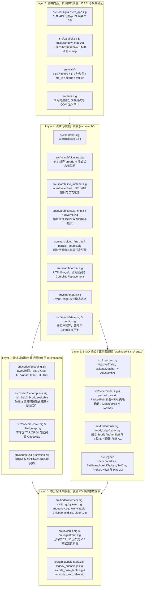

# libwebgrep 五层架构设计与人机协同开发指南（`v0.10.0`）

[English](ARCHITECTURE.md) | [简体中文](ARCHITECTURE.zh-CN.md)

`libwebgrep` 采用严格的**五层无环架构（5-Layer Acyclic Architecture）**，围绕**“检索准确第一、极致性能第二、代码优雅品味第三”**的原则构建，兼顾人类工程师直觉阅读与 AI 代理精准局部修改：

1. **检索准确第一（Accuracy First）**：所有 SIMD 向量原语、DFA/NFA 状态转移、流式转码/解压分块边界与上下文滑窗均由确定性单元测试、5 组跨层差分模糊测试套件与 `std.testing.checkAllAllocationFailures` 全路径 OOM 注入审计（`src/fuzz.zig`）双重兜底。
2. **极致性能第二（Extreme Performance Second）**：跨层采用 `comptime` 零成本单态化特化，核心热路径采用 4 向量展开 SIMD 循环（`@Vector`、`@splat`、`@ctz`/`@clz`）、自适应 4 路 ILP Aho-Corasick、零拷贝 8 MiB 滑窗 `mmap`、64B 对齐 `preadv`，并在回退路径标注 `@branchHint(.cold)`。
3. **优雅品味与人机协同第三（Elegant Code Taste Third）**：各模块职责清晰单一，顶部统一使用英文结构化模块契约注释（`//! [Module]`、`//! [Layer]`、`//! [Role]`、`//! [Invariants]`）。

---

## 1. 五层架构全景图

依赖方向严格自顶向下（Layer 5 -> Layer 1），底层模块绝不反向引用高层模块。



---

## 2. 分层模块职责索引

### Layer 1：零分配硬件原语、底层 I/O 与静态查表层
- `src/tables/unicode_prop_table.zig` 与 `src/tables/unicode_case_table.zig`：Unicode Simple Case Folding 静态等价类表、Unicode 通用类别与脚本属性表（`\p{...}` / `\P{...}`），以及 **UTS #18 Unicode 16.0 `prop_Word`**（`Alphabetic | M | Nd | Pc | Join_Control`）有序不重叠码点区间表（$O(\log K)$ 二分查找）。
- `src/tables/gbk_table.zig` 与 `src/tables/legacy_encodings.zig`：完整的 23,940 项 CP936/GBK/GB2312 映射表（配合 `encoding.zig` 的直查 UTF-8 LUT），以及 Windows-1252、Windows-1251、GB18030、Shift-JIS、EUC-JP、Big5 与 EUC-KR 紧凑解码表。
- `src/finder/memchr.zig`：全系采用 `@ctz`/`@clz` 的 4 向量展开 SIMD 查找与计数原语（`find`、`rfind`、`findEither`、`findAny`、`countByte`），并新增单 SIMD 向量同步探测分隔符 `\n` 与二进制哨兵 `\0` 的 **`findSepOrNul`**。
- `src/finder/ascii.zig`、`src/finder/byteset.zig`、`src/finder/frequency.zig`、`src/finder/two_way.zig`、`src/finder/bloom.zig`：无分支 ASCII 大小写折叠、16 桶 SIMD 字节集合、经验字节频率表、最坏 $O(n)$ Two-Way 算法与 N-gram 布隆过滤器预筛。
- `src/io/cpuid.zig` 与 `src/io/platform.zig`：`-Dteddy=runtime` 的运行时 `CPUID + OSXSAVE + XGETBV` 指令集检测，以及 Linux `POSIX_FADV_SEQUENTIAL` / `MADV_SEQUENTIAL` 封装。

### Layer 2：SIMD 模式与正则匹配层（`src/matcher.zig`、`src/finder/`、`src/regex/`）
- `src/matcher.zig`：定义携带 `pattern_id` 的 `Match`、`MatchMode`、`FindOptions`、`MatcherTraits(M)`、`validateMatcher(M)` 及运行时类型擦除 `AnyMatcher`。
- `src/finder/finder.zig`、`src/finder/packed_pair.zig`、`src/finder/unicode_fold.zig`：无锁 `*const Finder` 单字面量查找器，包含支持内联 `confirmFast`/`confirmFastFold` 与 `watch_nul` 确认的 `PackedPair`、单比特精确 `MaskedPair` SIMD 匹配器、自适应 `TwoWay` 回退与 ASCII 预过滤 Unicode 大小写折叠。
- `src/finder/multi.zig`、`src/finder/pairs.zig`、`src/finder/teddy*.zig`、`src/finder/aho.zig`：无锁 `*const Multi` 四级多模式 OR 引擎，精确输出 `pattern_id`：
  - **融合验证 `Teddy`（`findVerified` / `findVerifiedWatchingNul`）**：8 桶 Slim Teddy（`avx2`、`ssse3`、`neon`、`avx2_rt`），引入桶感知 Ghost-Byte 避让、纯数字 `(1,2)` 窗口惩罚与 3 字节内联过滤，使 `AltDfaVerifier` 在遭遇假阳性时保持单遍 `vpminub` 不中止。
  - **混合稠密+稀疏 4 路 ILP `AhoCorasick`（`src/finder/aho.zig`）**：将 L2 缓存常驻的预乘稠密 DFA 前缀（深度 0、全部深度 1 及按频排序 BFS 的深度 2 状态，并在 `u32` 转移值中打包 `MATCH_BIT`/`SPARSE_BIT`）与面向 500–2,000+ 模式的紧凑连续有序边 NFA 结合，辅以 AVX2 高半字节跳步与**自适应 4 路 ILP** 交错扫描。
- `src/regex.zig` 与 `src/regex/`（`inst.zig`、`compiler.zig`、`prefilter.zig`、`dfa.zig`、`vm.zig`、`set.zig`）：
  - **双层无锚定集合 DFA（`SetUnanchoredDfa` Tier A + `LazySetDfa` Tier B）**：基于字节等价类（`ByteClasses`），同时接入 `RegexSet` 与单正则 `Regex`，显著加速多分支与无字面量正则扫描。
  - **特化 DFA 与跨行快速路径**：支持精确 ASCII/词边界追踪的 `UnanchoredDfa`（含 `findEnd` 快速路径）、提升 `!has_loop_exits` 分支与 SIMD 自环快进的 `BoundedDfa`、跨行 **`PrefixAnyTail`**（`PREFIX.{m,n}TAIL`）、`ByteContextPrefilter`、Teddy 后缀提升与 `RegexSet` 统一多模式预过滤，并以无回溯 Thompson NFA / PikeVM 兜底保证严格线性时间。

### Layer 3：流式编解码与数据源契约层（`src/codec/`、`src/source.zig`、`src/sink.zig`）
- `src/codec/offset_map.zig`：强类型 `SearchByteOffset` / `RawByteOffset` 与区间级共线斜率压缩偏移映射表（`OffsetMap`）。
- `src/codec/encoding.zig`：BOM 嗅探、启发式编码检测、零拷贝 `Decoder` 缓冲、**SIMD UTF-16LE 批量转码**，以及**直查 UTF-8 GBK LUT + 寄存器驻留 Variant H GBK 快速路径**，完整覆盖 UTF-8/16/32、GBK/GB18030、Latin-1、Windows-1252/1251、Shift-JIS、EUC-JP、Big5 与 EUC-KR。
- `src/codec/decompress.zig`、`lz4.zig`、`bzip2.zig`、`brotli.zig`、`seekable.zig`：纯 Zig 进程内流式解压 **Gzip、Zlib、Deflate、Zstd、XZ、LZ4、Bzip2 与 Brotli**，内置双重压缩炸弹配额（`max_decompressed_bytes` + `max_compression_ratio`）与可寻址 Zstd/Gzip 随机索引。
- `src/codec/archive.zig`：零落盘内存归档解包引擎 `ArchiveTree`（支持 `.tar`、`.tar.gz`/`.tgz`、`.tar.zst`、`.tar.xz`、`.tar.bz2`、`.tar.lz4` 与 `.zip`/ZIP64 及嵌套归档）和恒定内存 `searchTarStream`，内置 Zip-Slip 路径穿越防御。
- `src/source.zig` 与 `src/sink.zig`：定义虚拟目录树 `Source`/`Memory` 游标与结构化事件 `Event`、`LineEvent`、`Result`、`Flow`、`AnyEventSink` 及 `SinkTraits(S)`。

### Layer 4：流式行检索引擎层（`src/searcher.zig` & `src/search/`）
- `src/search/config.zig` 与 `src/search/state.zig`：`SearchConfig`（含 `whole_word_unicode`、`optimalBufferSize`、`Scratch` 复用池）、单调时钟超时、扫描预算与编译期匹配器能力分发。
- `src/search/pipeline.zig`：`materialize`、`searchPrepared` 与流式分块驱动器 `drive`，内置 **64B 对齐 `preadv` 缓冲**（通过 `alignPad`/`realignSlice` 彻底消除 4K-aliasing 读写停顿）、自适应 128 KiB L1-DTLB / L2 NUL 分块扫描与 `matchedSpan` 流式输出。
- `src/search/line_matcher.zig`：核心 `matchBuffer`、单遍融合 **`scanFinderFast`（`lineEndOrNul` + 严格 `BinaryPolicy.quit`）**、`findLineLimitOpts`、批量反转计数 `matchInvert`、UTS #18 Unicode / ASCII 整词与整行校验及 `contains`/`excludes` 二次过滤。
- `src/search/context_ring.zig` 与 `src/search/reverse.zig`：惰性零拷贝 `BeforeRing` 前文环形缓冲、截断居中预览，以及支持 `-B`/`-A`/`-C` 上下文、解压与转码对齐的倒序尾部检索。
- `src/search/long_line.zig` 与 `src/search/parallel_source.zig`：超过 `max_line_len` 的超长行常数内存滑窗状态机与有界内存单源并发检索/计数引擎。
- `src/search/format.zig`：UTF-16 列号、`matched_raw_spans`、不重叠命中区间归集（含 `pattern_id`）与指针编译式 `CompiledReplacement`（支持 `$0`–`$32` 及 `${name}`）。
- `src/search/pull.zig` 与 `src/search/tree.zig`：`EventBridge(S)`、`SourcePull`（`openSourcePull`）、流式 `ReaderPull`（`openReaderPull`）与虚拟/归档树编排器（`searchTree`、`searchArchiveSlice`、`searchArchive`）。

### Layer 5：多源并发管线、滑窗 `mmap`、公共门面、C ABI 与验证层
- `src/io/window_map.zig`：Linux 大文件（`> 12 MiB`）**零拷贝 8 MiB 滑窗 `mmap`**（`searchFileWindowed`），通过一次性 `POSIX_FADV_SEQUENTIAL` + 逐窗 `MADV_SEQUENTIAL` 使 PTE 页表在 `munmap` 时保持 L2/L3 热态；不满足条件或非 Linux 平台自动平滑回退。
- `src/walk/`（`glob.zig`、`ignore.zig`、含 **172 种内置文件类型**的 `types.zig`、循环检测 `file_id.zig`、`list_dir.zig`、`deque.zig`、`walker.zig`）与 `src/parallel.zig` + `src/scheduler.zig`：受控工作窃取多源遍历，支持延迟目录 `fd` 打开、自适应文件任务批处理、`--mmap` 路径直接集成 `searchFileWindowed`，以及大文件并发升级前预发 `fadvise`。
- `src/root.zig`、`src/c_api.zig` 与 `src/c_api_ext.zig`（`include/webgrep.h`）：公共 Zig API 导出门面与 **59 函数**零 `libc` C ABI。
- `src/fuzz.zig` 与 `src/adversarial_probe_m5.zig`：**5 组跨层差分模糊测试套件**（覆盖 `UnanchoredDfa`/`SetUnanchoredDfa`/`LazySetDfa`、4 路 ILP AC / Teddy / `PackedPair` / `findSepOrNul`、`scanFinderFast` / `PrefixAnyTail` / `matchedSpan` / `CompiledReplacement`、Variant H GBK 快速路径，以及 `Finder`/`Multi`/`Regex`/`Decoder`/`searchSource` 差分神谕）与 **`std.testing.checkAllAllocationFailures` 全路径 OOM 注入审计**（`zig build fuzz`）。

---

## 3. 高扩展性开发指南

### 3.1 扩展自定义匹配器（`MatcherTraits`）
任何传入 `searchSlice`、`searchSourceSlice`、`searchSource`、`openSourcePull`、`openReaderPull` 或 `searchTree` 的匹配器指针 `*M` / `*const M`（或 `AnyMatcher`）均由 `src/matcher.zig` 中的 `validateMatcher(@TypeOf(matcher))` 在编译期自动校验：
- **必选方法**：`pub fn find(self: *const M, haystack: []const u8, start: usize, mode: MatchMode) ?Match`
- **可选零成本扩展钩子**（由 `MatcherTraits(M)` 在编译期自动探测并内联）：
  - `findWatched(self: *const M, haystack: []const u8, start: usize, mode: MatchMode, nul: *?usize) ?Match`：单遍融合二进制 NUL 字节检测。
  - `findAllowed(self: *const M, haystack: []const u8, start: usize, mode: MatchMode, comptime allow: fn ([]const u8, usize, usize) bool) ?Match`：在查找内核内部直接过滤不满足整词边界（`whole_word`）的候选位置。
  - `acceptsSpan(self: *const M, span: []const u8) bool`：自定义整行匹配（`whole_line`）快速路径。
  - `isMultiline(self: *const M) bool` 与 `multilineWindow(self: *const M) usize`：启用有界窗口跨行匹配。

### 3.2 扩展新字符集编码（`src/codec/encoding.zig`）
1. 在 `src/codec/encoding.zig` 的 `Encoding` 与 `Sniff` 枚举中增加新编码标识。
2. 在 `parseCharsetLabel` 中注册 WHATWG / MIME 字符集别名。
3. 在 `decodeStepMode` 中实现单步解码分支（`convertIntoWithMap` 整块高速路径与 `Decoder.emitPending` 流式分块路径将通过 `comptime` 自动特化生成对应机器码）。

---

## 4. Zig `0.17.1` 现代特性规范与验证命令

- **SIMD 与分支提示**：使用 `@Vector(width, u8)`、`@splat(...)` 与 `@ctz`/`@clz` 位掩码提取编写向量内循环；在错误分支、回退路径与慢速跨块路径标注 `@branchHint(.cold)`。
- **无管理容器初始化**：统一使用 `std.ArrayList(T) = .empty` 并显式传入 `allocator`。
- **完整验证命令**：
  ```sh
  zig build test --summary all
  zig build test -Dteddy=off --summary all
  zig build fuzz --summary all
  zig build bench -Doptimize=ReleaseFast -Dteddy=avx2
  ```
