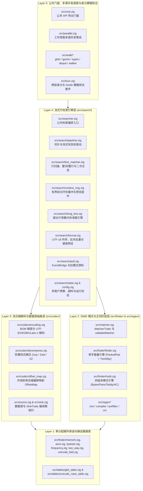

# libwebgrep 五层架构设计与人机协同开发指南

[English](ARCHITECTURE.md) | [简体中文](ARCHITECTURE.zh-CN.md)

`libwebgrep` 采用严格的**五层无环架构（5-Layer Acyclic Architecture）**，围绕**“检索准确第一、极致性能第二、代码优雅品味第三”**的原则构建，兼顾人类工程师直觉阅读与 AI 代理精准局部修改：

1. **检索准确第一（Accuracy First）**：所有 SIMD 向量原语、Thompson NFA 状态转移、流式转码/解压分块边界与上下文滑窗均由确定性单元测试与差分模糊测试（`src/fuzz.zig`）双重兜底。
2. **极致性能第二（Extreme Performance Second）**：跨层采用 `comptime` 零成本单态化特化，核心热路径采用 4 向量展开 SIMD 循环（`@Vector`、`@splat`）、无分支大小写折叠，并在异常/回退路径标注 `@branchHint(.cold)`。
3. **优雅品味与人机协同第三（Elegant Code Taste Third）**：每个实现文件聚焦单一职责（实现代码控制在 **150～800 行**），顶部统一使用英文结构化模块契约注释（`//! [Module]`、`//! [Layer]`、`//! [Role]`、`//! [Invariants]`）。

---

## 1. 五层架构全景图

依赖方向严格自顶向下（Layer 5 -> Layer 1），底层模块绝不反向引用高层模块。



---

## 2. 分层模块职责索引

### Layer 1：零分配硬件原语与静态查表层
- `src/tables/unicode_case_table.zig` 与 `src/tables/unicode_prop_table.zig`：Unicode Simple Case Folding 静态等价类表、Unicode 通用类别与脚本属性表（`\p{...}` / `\P{...}`）以及 UAX #29 Unicode 单词字符区间表。
- `src/tables/gbk_table.zig`：24 KiB 二级页索引 GBK / GB2312 转 Unicode 码点静态映射表。
- `src/finder/memchr.zig`：4 向量展开 SIMD 单字节/双字节/三字节查找与计数原语。
- `src/finder/ascii.zig`、`src/finder/byteset.zig`、`src/finder/frequency.zig`、`src/finder/two_way.zig`：无分支 ASCII 大小写折叠、16 桶 SIMD 字节集合、字节频率表与最坏 $O(n)$ Two-Way 算法。

### Layer 2：SIMD 模式与正则匹配层（`src/matcher.zig`、`src/finder/`、`src/regex/`）
- `src/matcher.zig`：定义携带 `pattern_id` 的 `Match`、`MatchMode`、`FindOptions`、`MatcherTraits(M)`、编译期契约校验器 `validateMatcher(M)` 及运行时类型擦除 `AnyMatcher`。
- `src/finder/finder.zig`、`src/finder/packed_pair.zig`、`src/finder/unicode_fold.zig`：无锁 `*const Finder` 单字面量查找器，结合稀有字节对 SIMD 过滤、自适应 `TwoWay` 回退与 SIMD 预过滤 Unicode 大小写折叠。
- `src/finder/multi.zig`、`src/finder/pairs.zig`、`src/finder/teddy*.zig`、`src/finder/aho.zig`：无锁 `*const Multi` 四级多模式 OR 引擎（`ByteSet` -> `RarePair` -> `Teddy` -> `AhoCorasick`），精确输出获胜模式的 `pattern_id`。
- `src/regex.zig` 与 `src/regex/`（`inst.zig`、`compiler.zig`、`prefilter.zig`、`dfa.zig`、`vm.zig`、`set.zig`、`tests.zig`）：模块化有界混合惰性 DFA + 锁步 Thompson NFA / PikeVM 正则引擎（`*const Regex`、`RegexScratch`）、多正则单遍集合 `RegexSet` 与结构化编译诊断 `CompileDiagnostic`。

### Layer 3：流式编解码与数据源契约层（`src/codec/`、`src/source.zig`、`src/sink.zig`）
- `src/codec/offset_map.zig`：强类型 `SearchByteOffset` / `RawByteOffset` 与共线斜率压缩稀疏锚点表 `OffsetMap`。
- `src/codec/decompress.zig`：进程内 Gzip / Zstd / XZ 流式解压与双重压缩炸弹拦截（`max_decompressed_bytes` + `max_compression_ratio`）。
- `src/codec/encoding.zig`：BOM 嗅探与 `comptime` 循环特化的流式转码器（`UTF-8`、`UTF-16LE`、`UTF-16BE`、`GBK`、`Latin-1`）。
- `src/codec/archive.zig`：零落盘内存归档解包引擎 `ArchiveTree`（支持 `.tar`、`.tar.gz`/`.tgz`、`.tar.zst`、`.tar.xz`、`.zip`），内置 Zip-Slip 路径穿越防御。
- `src/source.zig` 与 `src/sink.zig`：定义虚拟目录树 `Source`/`Memory` 游标与结构化事件 `Event`、`LineEvent`、`Result`、`Flow`、`AnyEventSink` 及 `SinkTraits(S)`。

### Layer 4：流式行检索引擎层（`src/searcher.zig` & `src/search/`）
- `src/search/config.zig`：`SearchConfig` 配置、工作线程零分配内存复用池 `Scratch` 与多租户安全硬顶。
- `src/search/state.zig`：检索运行期状态 `State`、单调时钟超时、扫描预算与匹配器能力分发。
- `src/search/context_ring.zig`：免回溯 `BeforeRing` 前文环形缓冲与匹配行截断居中预览。
- `src/search/format.zig`：UTF-16 列号计算、不重叠命中区间归集（含 `pattern_id`）、`$0`～`$9` 捕获组展开与事件格式化。
- `src/search/line_matcher.zig`：核心行扫描 `matchBuffer`、`findLine`、`matchInvert`、整词/整行校验及 `contains`/`excludes` 二次过滤。
- `src/search/long_line.zig`：超过 `max_line_len` 的超长行常数内存滑窗状态机（`beginLong`、`pumpLong`、`finishLong`）。
- `src/search/pull.zig`：`EventBridge(S)` 桥接器、切片拉模式迭代器 `SourcePull`（`openSourcePull`）与真流式增量拉模式迭代器 `ReaderPull`（`openReaderPull`）。
- `src/search/pipeline.zig`：切片预处理 `materialize`、`searchPrepared` 与流式分块驱动器 `drive`。
- `src/search/tree.zig`：虚拟树与内存归档检索编排器（`TreeConfig`、`searchTree`、`searchArchiveSlice`、`searchArchive`）。

### Layer 5：多源并发管线、公共门面、C ABI 与模糊测试层
- `src/walk/` 与 `src/parallel.zig`：受控并发目录/虚拟源遍历与工作窃取并行检索。
- `src/root.zig` 与 `src/c_api.zig`（`include/webgrep.h`）：公共 Zig API 导出门面与零 `libc` C ABI。
- `src/fuzz.zig` 与 `src/adversarial_probe_m5.zig`：跨层差分、属性模糊测试与红队对抗压测套件（`zig build fuzz`）。

---

## 3. 高扩展性开发指南

### 3.1 扩展自定义匹配器（`MatcherTraits`）
任何传入 `searchSlice`、`searchSourceSlice`、`searchSource`、`openSourcePull`、`openReaderPull` 或 `searchTree` 的匹配器指针 `*M` / `*const M`（或 `AnyMatcher`）均由 `src/matcher.zig` 中的 `validateMatcher(@TypeOf(matcher))` 在编译期自动校验：
- **必选方法**：`pub fn find(self: *const M, haystack: []const u8, start: usize, mode: MatchMode) ?Match`
- **可选零成本扩展钩子**（由 `MatcherTraits(M)` 在编译期自动探测并内联）：
  - `findWatched(self: *const M, haystack: []const u8, start: usize, mode: MatchMode, nul: *?usize) ?Match`：单遍融合二进制 NUL 字节检测。
  - `findAllowed(self: *const M, haystack: []const u8, start: usize, mode: MatchMode, comptime allow: fn ([]const u8, usize, usize) bool) ?Match`：在查找内核内部直接过滤不满足整词边界（`whole_word`）的候选位置。
  - `acceptsSpan(self: *const M, span: []const u8) bool`：自定义整行匹配（`whole_line`）快速路径。
  - `isMultiline(self: *const M) bool` 与 `multilineWindow(self: *const M) usize`：启用有界窗口跨行匹配。

### 3.2 扩展新字符集编码（`src/codec/encoding.zig`）
1. 在 `src/codec/encoding.zig` 的 `Encoding` 与 `Sniff` 枚举中增加新编码标识。
2. 在 `parseCharsetLabel` 中注册 WHATWG / MIME 字符集别名。
3. 在 `decodeStepMode` 中实现单步解码分支（`convertIntoWithMap` 整块高速路径与 `Decoder.emitPending` 流式分块路径将通过 `comptime` 自动特化生成对应机器码）。

---

## 4. Zig `0.17.1` 现代特性规范与验证命令

- **SIMD 与分支提示**：使用 `@Vector(width, u8)` 与 `@splat(...)` 编写向量内循环；在错误分支、回退路径与慢速跨块路径标注 `@branchHint(.cold)`。
- **无管理容器初始化**：统一使用 `std.ArrayList(T) = .empty` 并显式传入 `allocator`。
- **完整验证命令**：
  ```sh
  zig build test --summary all
  zig build fuzz --summary all
  zig build bench -Doptimize=ReleaseFast -Dteddy=avx2
  ```
