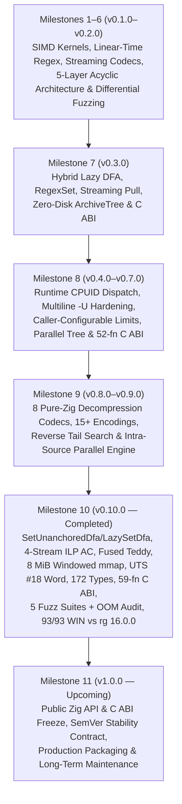

# libwebgrep Architecture Milestones & Roadmap

[English](ROADMAP.md) | [简体中文](ROADMAP.zh-CN.md)

All engineering, algorithmic, and performance milestones through **`v0.10.0`** have been completed, verified by **`1,027` unit/E2E/C ABI/differential-fuzz/OOM-audit tests** (`zig build test` and `zig build fuzz`), and benchmarked at **`93/93 100% WIN` (`1.82x` grand geomean)** against `ripgrep 16.0.0`. The next milestone is **`v1.0.0`**, focused on API freeze, C ABI stability guarantees, and long-term maintenance readiness.

| Milestone | Release | Focus Area | Key Modules | Status | Verification & Performance Highlights |
| :--- | :--- | :--- | :--- | :---: | :--- |
| **Milestones 1–6** | `v0.1.0`–`v0.2.0` | **Core SIMD Kernels, Linear-Time Regex, Streaming Codecs & 5-Layer Architecture** | `src/finder/*`, `src/regex/*`, `src/codec/*`, `src/search/*`, `src/walk/*`, `src/fuzz.zig` | **Completed** | 4-tier `Multi` (`ByteSet`/`RarePair`/`Teddy`/`AhoCorasick`); $O(n)$ Thompson NFA; Gzip/Zstd/XZ Zip-Bomb caps; strict 5-layer acyclic decomposition; `MatcherTraits` & `SinkTraits` |
| **Milestone 7** | `v0.3.0` | **Hybrid Lazy DFA, `RegexSet`, Streaming Pull, `ArchiveTree` & C ABI** | `src/regex/dfa.zig`, `src/regex/set.zig`, `src/codec/archive.zig`, `src/search/tree.zig`, `src/c_api.zig` | **Completed** | `*const` lock-free matchers; `pattern_id`; `\p{...}` Unicode properties; `openReaderPull`; `Scratch` pool; zero-disk `ArchiveTree` & `searchTree`; zero-`libc` C ABI |
| **Milestone 8** | `v0.4.0`–`v0.7.0` | **Runtime CPUID Dispatch, Multiline `-U` Hardening & Configurable Limits** | `src/io/cpuid.zig`, `src/io/platform.zig`, `src/search/pipeline.zig`, `src/search/config.zig`, `src/c_api_ext.zig` | **Completed** | `-Dteddy=runtime` baseline `x86_64` safety + `s390x` / `wasm32-wasi`; caller-configurable limits; cross-line `-U` & `--multiline-dotall` parity; constant-memory `searchTarStream`; 52-fn C ABI |
| **Milestone 9** | `v0.8.0`–`v0.9.0` | **Full Pure-Zig Codecs/Encodings, Reverse Search & Intra-Source Parallelism** | `src/codec/{lz4,bzip2,brotli,seekable}.zig`, `src/tables/legacy_encodings.zig`, `src/search/{reverse,parallel_source}.zig`, `src/scheduler.zig` | **Completed** | Zlib/Deflate/LZ4/Bzip2/Brotli + ZIP64/nested archives; 15+ encodings & heuristic detection; Unicode `\d`/`\w`/`\s`; reverse tail search with context; bounded-memory intra-source parallel engine |
| **Milestone 10** | **`v0.10.0`** | **Two-Tier Set DFA, 4-Stream ILP AC, Windowed `mmap`, UTS #18 Word & 93/93 `rg 16.0.0` Sweep** | `src/regex/{dfa,set,vm}.zig`, `src/finder/{aho,teddy,packed_pair,memchr}.zig`, `src/io/window_map.zig`, `src/parallel.zig`, `src/tables/unicode_prop_table.zig`, `src/walk/types.zig`, `src/fuzz.zig` | **Completed** | **`93/93 100% WIN`** vs `ripgrep 16.0.0` (`1.82x` grand geomean; Core `1.31x`, Stress `1.89x`, `S15 --mmap` **`25.31 GB/s`**); `SetUnanchoredDfa`/`LazySetDfa` in `Regex` & `RegexSet`; 4-stream ILP AC (`20.56 GB/s`); fused `Teddy` `findVerified` + ghost-byte avoidance; zero-copy 8 MiB windowed `mmap`; 64B-aligned `preadv`; SIMD GBK LUT/Variant H & UTF-16LE; UTS #18 Unicode 16.0 `prop_Word`; 172 file types; 59-fn C ABI; **`1,027`** AVX2 / **`1,013`** `-Dteddy=off` tests + 5 differential fuzz suites & OOM audit |
| **Milestone 11** | **`v1.0.0`** | **API Freeze & Long-Term Stability Release** | `src/root.zig`, `include/webgrep.h`, `docs/API.md` | **Upcoming** | Freeze public Zig API surface and 59-function C ABI binary/header compatibility; publish SemVer stability guarantees, ABI compatibility checks, and long-term maintenance policy |
