# libwebgrep Architecture Milestones

[English](ROADMAP.md) | [简体中文](ROADMAP.zh-CN.md)

All planned capability and architectural milestones for `libwebgrep` have been completed, verified by unit and differential fuzz tests (`zig build test` and `zig build fuzz`), and benchmarked in `ReleaseFast` mode.

```mermaid
flowchart TD
    M0["Milestone 1: Core SIMD Kernels & Streaming Searcher<br/>memchr / PackedPair / TwoWay / ByteSet / RarePair / Teddy / AhoCorasick<br/>Constant-memory sliding window, bounded context, multi-tenant budgets"] --> M1["Milestone 2: High-Value Query Semantics<br/>Pattern list parser (Multi.initFromText), ordered-stream early stop,<br/>full-stream highlighting (passthru), read-only replacement preview"]
    M1 --> M2["Milestone 3: Linear-Time Regex + SIMD Prefilter<br/>Lockstep Thompson NFA / PikeVM, compile size hard cap,<br/>RequiredLiteral & Multi alternation SIMD prefilters, bounded multiline window"]
    M2 --> M3["Milestone 4: Bomb-Safe Streaming Decompression & Encodings<br/>In-process Gzip / Zstd / XZ with dual Zip-Bomb caps,<br/>SIMD-prefiltered Unicode Case Folding, GBK / Latin-1 transcoding, raw_offset mapping"]
    M3 --> M4["Milestone 5: Controlled Multi-Source Pipeline<br/>Nested brace globbing with caps, in-memory & layered Ignore rules,<br/>injectable file-type tables, controlled worker concurrency & streaming events"]
    M4 --> M5["Milestone 6: 5-Layer Architecture & Differential Fuzzing<br/>Modular tables/codec/regex/search decomposition, MatcherTraits & SinkTraits,<br/>Zig 0.17.1 Smith + PRNG differential fuzz suite (src/fuzz.zig)"]
    M5 --> M6["Milestone 7 (v0.3.0): Hybrid Lazy DFA, RegexSet, Streaming Pull, ArchiveTree & C ABI<br/>*const lock-free matchers, pattern_id, Unicode properties & UAX #29 word boundaries,<br/>openReaderPull, Scratch pool, zero-disk ArchiveTree/searchTree, zero-libc C ABI"]
```

| Milestone | Focus Area | Key Modules | Status | Verification & Performance Highlights |
| :--- | :--- | :--- | :---: | :--- |
| **Milestone 1** | **Core SIMD Kernels & Multi-Tenant Searcher** | `src/finder/*`, `src/search/*`, `src/sink.zig` | **Completed** | 24–62 GB/s SIMD kernel throughput; zero-allocation slice search; fused single-pass NUL detection |
| **Milestone 2** | **High-Value Query Semantics** | `src/finder/multi.zig`, `src/search/*`, `src/sink.zig` | **Completed** | `Multi.initFromText` pre-allocation limit check; `stop_on_nonmatch`; `passthru`; read-only `replacement` preview |
| **Milestone 3** | **Linear-Time Regex + SIMD Prefilter** | `src/regex/*`, `src/search/*` | **Completed** | Worst-case $O(n)$ Thompson NFA; 4096-instruction hard cap; prefix/interior/tail/alternation SIMD prefilters; bounded multiline |
| **Milestone 4** | **Streaming Decompression & Extended Encodings** | `src/codec/*`, `src/tables/*`, `src/finder/unicode_fold.zig` | **Completed** | In-process Gzip/Zstd/XZ Zip-Bomb protection (`max_decompressed_bytes` + `max_compression_ratio`); 28.9 GB/s SIMD Unicode case folding; comptime-specialized UTF-16/GBK/Latin-1 & `OffsetMap` |
| **Milestone 5** | **Controlled Multi-Source Pipeline** | `src/walk/*`, `src/parallel.zig` | **Completed** | Nested `{a,{b,c}}` glob expansion with caps; pure-text & `.gitignore`/`.ignore`/`.rgignore` switches; `expandTypesToGlobs`; strict `max_concurrency` |
| **Milestone 6** | **5-Layer Co-Development Architecture & Fuzzing** | `src/tables/*`, `src/codec/*`, `src/regex/*`, `src/search/*`, `src/fuzz.zig` | **Completed** | Strict 5-layer acyclic decomposition; `MatcherTraits` & `SinkTraits` compile-time contracts; Zig 0.17.1 `std.testing.fuzz` + multi-seed differential fuzzers |
| **Milestone 7 (`v0.3.0`)** | **Hybrid Lazy DFA, `RegexSet`, Streaming Pull, `ArchiveTree` & C ABI** | `src/regex/dfa.zig`, `src/regex/set.zig`, `src/codec/archive.zig`, `src/search/tree.zig`, `src/c_api.zig` | **Completed** | `*const` lock-free matchers; `pattern_id`; `\p{...}` Unicode properties & UAX #29 `\b`/`\B`; `CompileDiagnostic`; `openReaderPull`; `Scratch` pool; zero-disk `ArchiveTree` & `searchTree`; C ABI (`include/webgrep.h`) |

