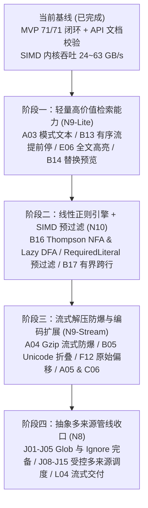

# libwebgrep 演进路线与高性能实现计划

本计划基于 **MVP（N0～N7、N11）与 P2 多模式 SIMD 内核优化全部完成** 的当前基线制定，旨在以最高投入产出比（ROI）推进剩余的 **N9（内容处理）**、**N10（线性正则）** 与 **N8（多来源管线）** 能力。

---

## 一、演进总览与阶段划分

| 阶段 | 聚焦主题 | 覆盖功能点 | 状态 | 核心性能与安全指标 |
| :--- | :--- | :--- | :---: | :--- |
| **阶段一** | **轻量高价值检索能力** | `A03`, `B13`, `E06`, `B14` | **已完成 (DONE)** | 零新增外部依赖；有序日志流查询提前终止；替换与全文高亮严格受 `max_output_bytes` 约束 |
| **阶段二** | **线性正则 + SIMD 预过滤** | `B16`, `B17` | **已完成 (DONE)** | 编译大小硬顶防爆；最坏 $O(n)$ 步数保证；利用 `RequiredLiteral` 保持 20+ GB/s 级预过滤吞吐 |
| **阶段三** | **流式解压与编码扩展** | `A04`, `B05`, `F12`, `A05`, `C06` | **已完成 (DONE)** | Gzip/Zstd/XZ 进程内流式解压 + 压缩比/输出字节双硬顶拦截 Zip Bomb；Unicode 折叠不劣化 ASCII SIMD 快路径 |
| **阶段四** | **抽象多来源管线收口** | `J01`–`J05`, `J08`, `J09`, `J11`–`J15`, `L04` | 待实施 | Glob/Ignore 条数与深度硬顶；移除 CPU 核数探测，完全由 `max_concurrency` 驱动；不缓存全量事件 |

---

## 二、分阶段详细实施表

### 阶段一：轻量高价值检索能力（N9-Lite，已完成）

无需引入复杂状态机或外部格式解析，直接增强 Web 日志与代码搜索的高频查询体验。

| 任务项 | 目标模块 | 高性能实现方案 | 验收测试标准 | 状态 |
| :--- | :--- | :--- | :--- | :---: |
| **1. 模式列表文本解析 (`A03`)** | `src/finder/multi.zig` `src/matcher.zig` | 提供 `Multi.initFromText(allocator, text, options)`：按 `\n`（兼容 `\r\n`）切分模式行，空行转为空模式 `""`，在分配自动机前先统计行数与总字节并调用 `checkPatternLimits`。 | `test "A03 空行模式匹配所有行且超限在构造前拒绝"` | **DONE** |
| **2. 有序流提前停止 (`B13`)** | `src/searcher.zig` | 在 `SearchConfig` 新增 `stop_on_nonmatch: bool = false`。在 `matchBuffer` 中，当 `state.matched_lines > 0` 后若下一条命中行起点跳过未命中行（或当前块末尾存在未命中完整行），立即停止并触发 `close_input`。 | `test "B13 有序输入在首条不匹配行处停止并关闭上游"` | **DONE** |
| **3. 全文高亮模式 (`E06`)** | `src/searcher.zig` `src/sink.zig` | 在 `SearchConfig` 新增 `passthru: bool = false`。开启时未命中行也通过事件流交出（`matches` 为空切片），命中行附带全部匹配区间；所有输出行字节统一计入 `max_output_bytes`，超限时停止并置 `partial = true`。 | `test "E06 全文高亮输出全部行且受输出字节上限约束"` | **DONE** |
| **4. 只读替换预览 (`B14`)** | `src/sink.zig` `src/searcher.zig` | 在 `SearchConfig` 新增 `replacement: ?[]const u8 = null`。在生成行事件时按匹配区间拼接只读预览或填充区间替换文本，绝不修改输入缓冲。 | `test "B14 替换预览不修改输入且区间与替换文本一致"` | **DONE** |

---

### 阶段二：线性时间正则引擎 + SIMD 字面量预过滤（N10，已完成）

这是检索引擎从「纯字面量」迈向「全功能代码/日志检索」的核心节点。**设计铁律：绝不用裸 DFA 硬扫全文，必须把正则嫁接在现有的 24～42 GB/s SIMD 字面量内核之上。**

| 任务项 | 目标模块 | 高性能实现方案 | 验收测试标准 | 状态 |
| :--- | :--- | :--- | :--- | :---: |
| **1. 线性正则编译器与硬顶 (`B16`)** | `src/regex.zig` | 实现无回溯的 Thompson NFA 指令编译器（支持字符类、量词、交替、分组与锚点）。内置服务端编译大小硬顶（指令数与跨行窗口上限），超限在扫描前返回 `RegexTooLarge`。 | `test "B16 正则编译大小超过硬顶时拒绝"` `test "B16 病态模式步数随输入长度线性增长"` | **DONE** |
| **2. `RequiredLiteral` 提取与 SIMD 预过滤 (`B16`)** | `src/regex.zig` | 从正则语法树提取必需字面量（前缀与尾随双字面量交由 `Finder`）。扫描时先由 SIMD 字面量内核定位候选位置与行窗口，再仅在候选窗口内运行 Thompson NFA 确认。 | `test "B16 RequiredLiteral 提取与 SIMD 预过滤命中"` `test "B16 正则与 Searcher 联动及替换预览"` | **DONE** |
| **3. 有界窗口跨行匹配 (`B17`)** | `src/regex.zig` `src/searcher.zig` | 支持跨行模式（`multiline`），但跨行跨度严格限制在 `max_multiline_window` 与 `max_line_len` 内；窗口填满仍未闭合匹配时立即判定该起点失配，不无限读取上游。 | `test "B17 有界跨行窗口内命中且超窗立即失配"` `test "B17 跨行窗口耗尽后不再读上游"` | **DONE** |

---

### 阶段三：流式防爆解压与编码/Unicode 扩展（N9-Stream，已完成）

面向归档日志流（`.gz` / `.zst` / `.xz`）与多语言文本搜索，所有解压与转码严格纳入 `SearchConfig` 的预算体系。

| 任务项 | 目标模块 | 高性能实现方案 | 验收测试标准 | 状态 |
| :--- | :--- | :--- | :--- | :---: |
| **1. 进程内 Gzip 流式防爆解压 (`A04`)** | `src/decompress.zig` `src/searcher.zig` | 在读取层串联进程内 Gzip 流式解压器（识别 `1F 8B` 魔数或显式配置）。每产出解压字节实时累加 `state.decompressed_bytes`，同时检查 `max_decompressed_bytes` 与 `max_compression_ratio`（默认 `100:1`），超限立即返回 `LimitHit.decompressed_bytes`。 | `test "A04 gzip 炸弹被压缩比与解压字节上限拦截"` | **DONE** |
| **2. Unicode 简单大小写折叠 (`B05`)** | `src/finder/unicode_fold.zig` `src/finder/multi.zig` | **分层加速**：默认保持纯 ASCII `(block \| 0x20) == lower` 25 GB/s 快路径；开启 `unicode_case` 时按单条模式的智能大小写将 Unicode 折叠变体展开至 `Multi` SIMD 引擎。 | `test "B05 Unicode 折叠按单条模式智能大小写生效"` | **DONE** |
| **3. 原始流偏移映射 (`F12`)** | `src/decompress.zig` `src/encoding.zig` `src/sink.zig` | 在流式转码（UTF-16 / GBK → UTF-8）与流式解压中维护 `OffsetMap` 偏移锚点，在 `LineEvent` 与 `Line` 中提供 `raw_offset` 字段。 | `test "F12 转码与解压后仍能给出原始字节流偏移"` | **DONE** |
| **4. 扩展压缩与编码 (`A05`, `C06`)** | `src/decompress.zig` `src/encoding.zig` | 接入进程内 `zstd`/`xz` 解压器（共用 `A04` 防爆配额，损坏流归入 `SoftError`）；在 `encoding.zig` 中增加 WHATWG 标签解析、HTTP `charset` 提示及 GBK / Latin-1 流式转码。 | `test "A05 zstd 解压共用防爆上限且损坏归为软错误"` `test "C06 GBK 与 charset 提示转码命中"` | **DONE** |

---

### 阶段四：抽象多来源文件管线收口（N8）

将现有的 `src/walk/` 与 `src/parallel.zig` 彻底脱离 OS 路径假设，收口到抽象 `Source` 与多租户并发配额之下。

| 任务项 | 目标模块 | 高性能实现方案 | 验收测试标准 |
| :--- | :--- | :--- | :--- |
| **1. Glob 完备化与上限保护 (`J01`, `J02`)** | `src/walk/glob.zig` | 增加嵌套花括号 `{a,{b,c}}` 展开器、规则条数与长度硬顶校验，以及 `--iglob` ASCII 大小写不敏感匹配。 | `test "J01 后写的 glob 优先且花括号可嵌套并受上限保护"` `test "J02 glob 忽略大小写"` |
| **2. Ignore 规则与类型表注入 (`J03`–`J05`, `J08`, `J12`)** | `src/walk/ignore.zig` `src/walk/types.zig` | 支持纯文本忽略规则注入（不收路径），支持无 `.git` 目录时读取 `.gitignore`/`.ignore`/`.rgignore`，提供 `dot`/`exclude`/`vcs`/大小写独立开关；提供接收调用方类型表的 `expandTypesToGlobs` 接口。 | `test "J04 无 git 目录时忽略规则同样生效"` `test "J05 纯文本忽略规则与 J08 细分开关"` |
| **3. 受控并发与遍历预算 (`J09`, `J11`, `J13`–`J15`, `L04`)** | `src/walk/walker.zig` `src/parallel.zig` | 固定服务端最大遍历深度（`J09`）；支持仅列出来源并计入遍历预算（`J13`）；从生产代码中移除 `getCpuCount`，工作线程数严格由调用方 `max_concurrency` 决定（`J14`）；确保多来源边搜边交出 `end`，绝不为排序缓存全量事件（`L04`）。 | `test "J13 仅列出来源计入遍历预算"` `test "J14 线程数严格受控且不探测 CPU 核数"` |

---

## 三、开发与合入守则

1. **性能不退化红线**：任何新功能合入前必须运行 `zig build bench -Doptimize=ReleaseFast` 与 `./zig-out/bin/libwebgrep-bench-orig` 对照，默认配置下的字面量与多模式吞吐不得退化。
2. **文档与代码同步契约**：凡修改或新增 `src/root.zig` 导出的公共符号，必须在同一提交中同步更新 `docs/API.md` 及对应 `///` 文档注释，并确保 `zig build test`（含 `api-doc-example` 与 `checkApiDoc`）零错误通过。
3. **安全审查自动化**：每次阶段收口时，在 `src/` 下复核禁止项关键字（`follow_symlinks`、`ChildProcess`、`execve`、`getenv`、`PCRE`、`ANSI`），确保全部保持 `ABSENT-OK`。
