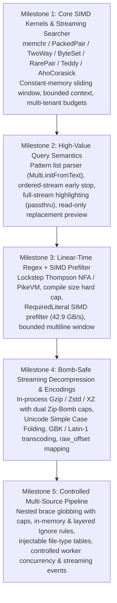

# libwebgrep Architecture Milestones

All planned capability milestones for `libwebgrep` have been completed, verified by unit and fuzz tests, and benchmarked in `ReleaseFast` mode.

| Milestone | Focus Area | Key Modules | Status | Verification & Performance Highlights |
| :--- | :--- | :--- | :---: | :--- |
| **Milestone 1** | **Core SIMD Kernels & Multi-Tenant Searcher** | `src/finder/*`, `src/searcher.zig`, `src/sink.zig` | **Completed** | 24–62 GB/s SIMD kernel throughput; zero-allocation slice search; fused single-pass NUL detection |
| **Milestone 2** | **High-Value Query Semantics** | `src/finder/multi.zig`, `src/searcher.zig`, `src/sink.zig` | **Completed** | `Multi.initFromText` pre-allocation limit check; `stop_on_nonmatch`; `passthru`; read-only `replacement` preview |
| **Milestone 3** | **Linear-Time Regex + SIMD Prefilter** | `src/regex.zig`, `src/searcher.zig` | **Completed** | Worst-case $O(n)$ Thompson NFA; 4096-instruction hard cap; 42.87 GB/s `RequiredLiteral` SIMD prefilter; bounded multiline |
| **Milestone 4** | **Streaming Decompression & Extended Encodings** | `src/decompress.zig`, `src/encoding.zig`, `src/finder/unicode_fold.zig` | **Completed** | In-process Gzip/Zstd/XZ Zip-Bomb protection (`max_decompressed_bytes` + `max_compression_ratio`); Unicode case folding; GBK/Latin-1 & `raw_offset` |
| **Milestone 5** | **Controlled Multi-Source Pipeline** | `src/walk/*`, `src/parallel.zig` | **Completed** | Nested `{a,{b,c}}` glob expansion with caps; pure-text & `.gitignore`/`.ignore`/`.rgignore` switches; `expandTypesToGlobs`; strict `max_concurrency` |
