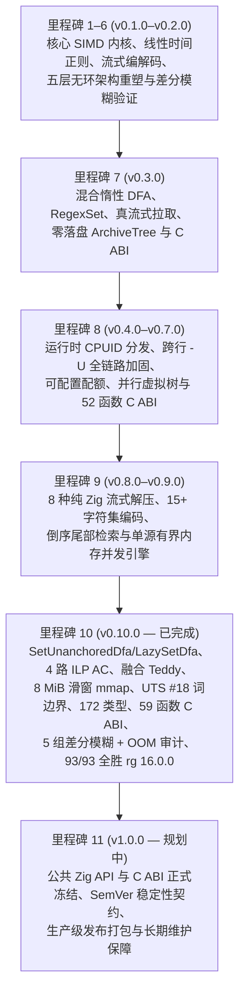

# libwebgrep 架构演进里程碑与路线图

[English](ROADMAP.md) | [简体中文](ROADMAP.zh-CN.md)

`libwebgrep` 截至 **`v0.10.0`** 的全部功能、算法与架构演进里程碑均已 100% 完成，通过 **`1,027` 项单元/端到端/C ABI/差分模糊/OOM 审计测试**（`zig build test` 与 `zig build fuzz`），并在对标 `ripgrep 16.0.0` 的 93 项全量评测中达成 **`93/93 100% WIN`（总几何均值 `1.82x`）**。下一阶段里程碑为 **`v1.0.0`**，聚焦公共 API 冻结、C ABI 稳定性契约与长期维护就绪。

| 里程碑 | 版本 | 核心方向 | 关键模块 | 状态 | 验证与性能亮点 |
| :--- | :--- | :--- | :--- | :---: | :--- |
| **里程碑 1–6** | `v0.1.0`–`v0.2.0` | **核心 SIMD 内核、线性时间正则、流式编解码与五层架构** | `src/finder/*`, `src/regex/*`, `src/codec/*`, `src/search/*`, `src/walk/*`, `src/fuzz.zig` | **已完成** | 四级 `Multi`（`ByteSet`/`RarePair`/`Teddy`/`AhoCorasick`）；$O(n)$ Thompson NFA；Gzip/Zstd/XZ 双重防爆；五层无环拆解；`MatcherTraits` 与 `SinkTraits` |
| **里程碑 7** | `v0.3.0` | **混合惰性 DFA、`RegexSet`、流式拉取、内存归档与 C ABI** | `src/regex/dfa.zig`, `src/regex/set.zig`, `src/codec/archive.zig`, `src/search/tree.zig`, `src/c_api.zig` | **已完成** | `*const` 无锁匹配器；`pattern_id`；`\p{...}` Unicode 属性；`openReaderPull`；`Scratch` 池；零落盘 `ArchiveTree` & `searchTree`；零 `libc` C ABI |
| **里程碑 8** | `v0.4.0`–`v0.7.0` | **运行时 CPUID 分发、跨行 `-U` 加固与可配置配额** | `src/io/cpuid.zig`, `src/io/platform.zig`, `src/search/pipeline.zig`, `src/search/config.zig`, `src/c_api_ext.zig` | **已完成** | `-Dteddy=runtime` 基线 `x86_64` 安全与 `s390x`/`wasm32-wasi` 兼容；调用方可配置上限；跨行 `-U` / `--multiline-dotall` 全链路对齐；恒定内存 `searchTarStream`；52 函数 C ABI |
| **里程碑 9** | `v0.8.0`–`v0.9.0` | **全量纯 Zig 编解码器、倒序检索与单源并发引擎** | `src/codec/{lz4,bzip2,brotli,seekable}.zig`, `src/tables/legacy_encodings.zig`, `src/search/{reverse,parallel_source}.zig`, `src/scheduler.zig` | **已完成** | Zlib/Deflate/LZ4/Bzip2/Brotli 与 ZIP64/嵌套归档；15+ 编码与启发式检测；Unicode `\d`/`\w`/`\s`；带上下文的倒序尾部检索；有界内存单源并发引擎 |
| **里程碑 10** | **`v0.10.0`** | **双层集合 DFA、4 路 ILP AC、滑窗 `mmap`、UTS #18 词边界与 93/93 全胜 `rg 16.0.0`** | `src/regex/{dfa,set,vm}.zig`, `src/finder/{aho,teddy,packed_pair,memchr}.zig`, `src/io/window_map.zig`, `src/parallel.zig`, `src/tables/unicode_prop_table.zig`, `src/walk/types.zig`, `src/fuzz.zig` | **已完成** | 对标 `ripgrep 16.0.0` **`93/93 100% WIN`**（总几何均值 `1.82x`；Core `1.31x`、Stress `1.89x`、`S15 --mmap` **`25.31 GB/s`**）；`SetUnanchoredDfa`/`LazySetDfa` 接入 `Regex` 与 `RegexSet`；4 路 ILP AC（`20.56 GB/s`）；融合 `Teddy` `findVerified` + Ghost-Byte 避让；零拷贝 8 MiB 滑窗 `mmap`；64B 对齐 `preadv`；SIMD GBK LUT/Variant H 与 UTF-16LE；UTS #18 Unicode 16.0 `prop_Word`；172 种内置文件类型；59 函数 C ABI；**`1,027`**（AVX2）/ **`1,013`**（`-Dteddy=off`）测试 + 5 组差分模糊测试与 OOM 注入审计 |
| **里程碑 11** | **`v1.0.0`** | **API 冻结与长期稳定性发布** | `src/root.zig`, `include/webgrep.h`, `docs/API.md` | **规划中** | 正式冻结公共 Zig API 与 59 函数 C ABI 头文件/二进制兼容契约；建立 SemVer 稳定性保障、ABI 回归校验与长期维护策略 |
