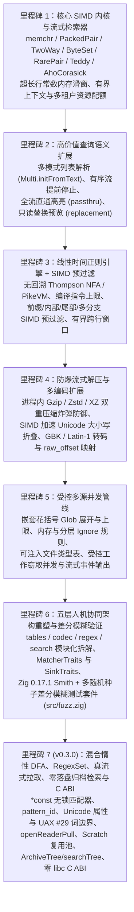

# libwebgrep 架构演进里程碑

[English](ROADMAP.md) | [简体中文](ROADMAP.zh-CN.md)

`libwebgrep` 规划的全部功能与五层架构演进里程碑均已 100% 完成，并通过完整的单元测试、差分模糊测试（`zig build test` 与 `zig build fuzz`）及 `ReleaseFast` 微基准实测验证。

| 里程碑 | 核心方向 | 关键模块 | 状态 | 验证与性能亮点 |
| :--- | :--- | :--- | :---: | :--- |
| **里程碑 1** | **核心 SIMD 内核与多租户检索器** | `src/finder/*`, `src/search/*`, `src/sink.zig` | **已完成** | 24～62 GB/s SIMD 内核吞吐；零分配切片检索；单遍融合 NUL 二进制检测 |
| **里程碑 2** | **高价值查询语义** | `src/finder/multi.zig`, `src/search/*`, `src/sink.zig` | **已完成** | `Multi.initFromText` 分配前配额校验；`stop_on_nonmatch`；`passthru`；只读 `$0`～`$9` `replacement` 预览 |
| **里程碑 3** | **线性时间正则 + SIMD 预过滤** | `src/regex/*`, `src/search/*` | **已完成** | 最坏 $O(n)$ Thompson NFA；4096 指令硬顶；前缀/内部/尾部/多分支自动 SIMD 预过滤；有界跨行匹配 |
| **里程碑 4** | **流式防爆解压与扩展字符集** | `src/codec/*`, `src/tables/*`, `src/finder/unicode_fold.zig` | **已完成** | 进程内 Gzip/Zstd/XZ 双重防爆保护；28.9 GB/s SIMD 加速 Unicode 大小写折叠；`comptime` 特化 UTF-16/GBK/Latin-1 转码与 `OffsetMap` |
| **里程碑 5** | **受控多源并发管线** | `src/walk/*`, `src/parallel.zig` | **已完成** | `{a,{b,c}}` 嵌套花括号展开；纯文本与 `.gitignore`/`.ignore`/`.rgignore` 开关；`expandTypesToGlobs`；严格 `max_concurrency` |
| **里程碑 6** | **五层人机协同架构与差分模糊测试** | `src/tables/*`, `src/codec/*`, `src/regex/*`, `src/search/*`, `src/fuzz.zig` | **已完成** | 严格五层无环架构拆解；`MatcherTraits` 与 `SinkTraits` 编译期扩展契约；Zig 0.17.1 `std.testing.fuzz` + 跨层差分模糊测试 |
| **里程碑 7 (`v0.3.0`)** | **混合惰性 DFA、`RegexSet`、流式拉取、内存归档与 C ABI** | `src/regex/dfa.zig`, `src/regex/set.zig`, `src/codec/archive.zig`, `src/search/tree.zig`, `src/c_api.zig` | **已完成** | `*const` 无锁匹配器；`pattern_id`；`\p{...}` Unicode 属性与 UAX #29 `\b`/`\B`；`CompileDiagnostic`；`openReaderPull`；`Scratch` 池；零落盘 `ArchiveTree` & `searchTree`；C ABI（`include/webgrep.h`） |

